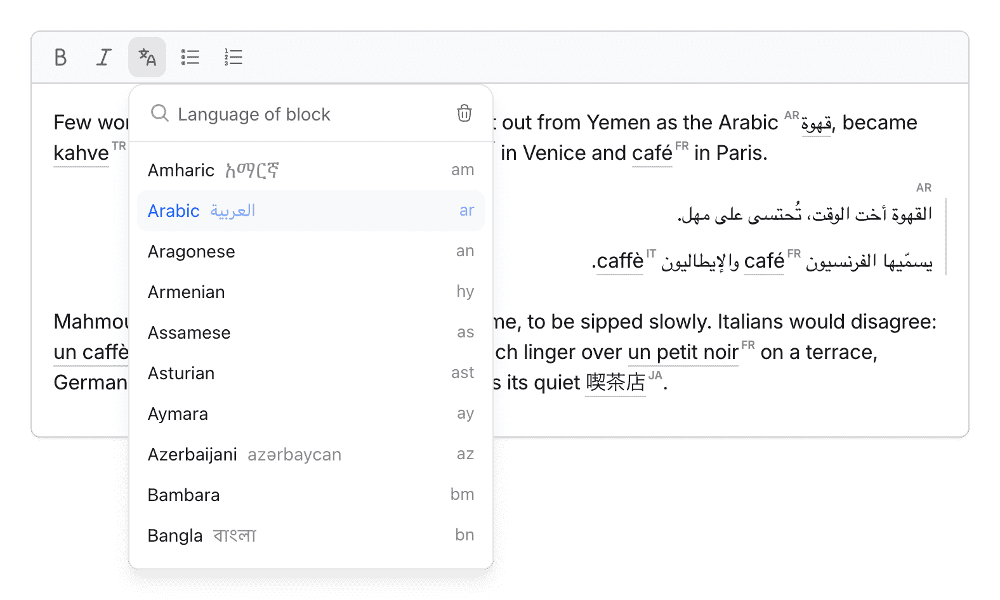

# Statamic Bard Languages

**Mark words and sections of Bard content as written in another language.**



## How it works

Editors pick a language for a phrase or a whole block. The addon adds a `lang` attribute, plus a `dir` attribute derived from the language. Screen readers, hyphenation, spell checkers, translation tools, and fonts all use the `lang` attribute to handle text correctly. Right-to-left passages render correctly in a left-to-right page.

```html
Say
  <span lang="fr" dir="ltr">bonjour</span>
or
  <span lang="ar" dir="rtl">مرحبا</span>.
```

## Quick start

### Install the addon

```sh
composer require daun/statamic-bard-languages
```

### Add the button

Add the `language` button to a Bard field, either in the blueprint editor or in its YAML:

```yaml
type: bard
buttons:
  - bold
  - italic
  - language
```

### Render the content

Nothing to do. Bard outputs the `lang` and `dir` attributes like any other markup.

```antlers
{{ content }}
```

## Documentation

Read the detailed [documentation](DOCUMENTATION.md) for how selections are marked, language suggestions, restricting languages, and text direction.

## License

[MIT](LICENSE)
